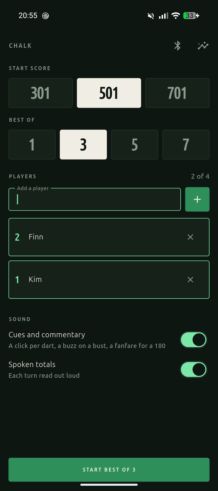
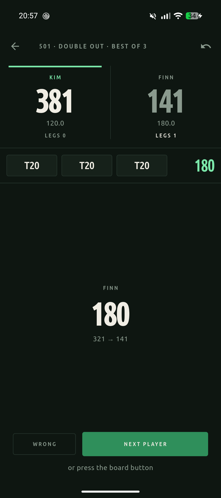
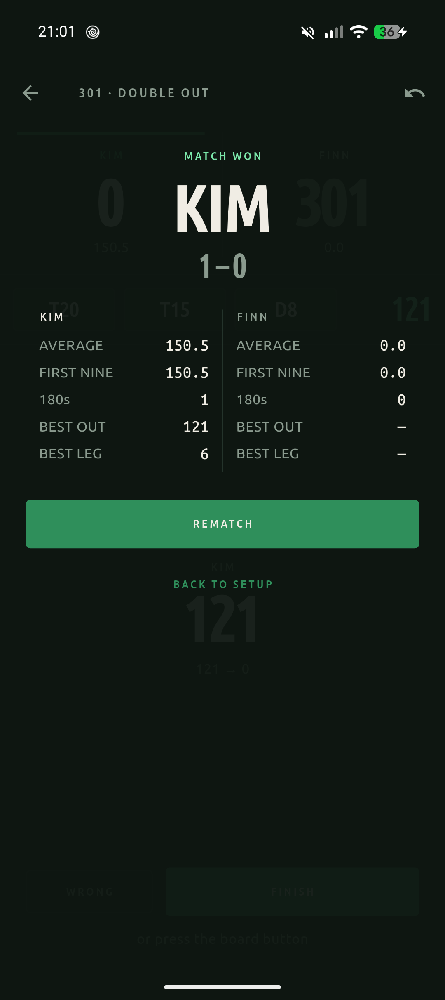
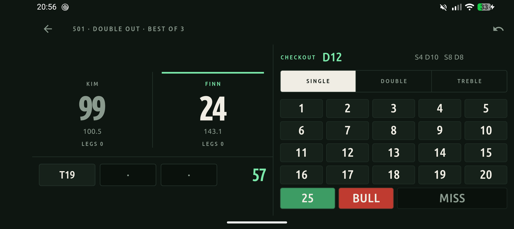

<div align="center">

# Chalk

**A darts scorer for the GranBoard 132, in the shape of the board rather than the shape of a form.**

[](https://flutter.dev)
[](https://dart.dev)
[](#)
[](https://github.com/Filan-glitch/FlutterGran/releases/latest)
[](https://github.com/Filan-glitch/FlutterGran/actions/workflows/ci.yml)
[](https://filan-glitch.github.io/FlutterGran/)

x01 for up to four players, best of 1/3/5/7, live checkout suggestions, spoken
commentary rendered at build time, reactions on the board's LED ring, and
per-player statistics across every dart ever thrown — plus Around the Clock,
Bulling, Higher/Lower and training. With the board connected over Bluetooth,
or with nothing but the keypad.

</div>

---

<div align="center">







</div>

---

## What it does

| | |
|---|---|
| **x01** | 301 / 501 / 701, straight, double or master in and out, one to four players |
| **Matches** | Best of 1, 3, 5 or 7. The throw rotates every leg, because throwing first is a real advantage |
| **Checkouts** | Every route out under the leg's out-rule, live, with the suggested keys outlined on the keypad |
| **Around the Clock** | 1 to 20, then the outer bull and the bullseye; any segment counts, or only doubles and triples (masters), or only doubles |
| **Bulling** | Points on the bull (outer 1, bullseye 2 or 3), first to 21, 31 or 41 |
| **Higher/Lower** | Elimination: every turn must beat the higher value or undercut the lower one, last one standing wins |
| **Training** | Free practice, Checkout Challenge (random finishes, adaptive range), 121 Ladder, Bob's 27, and a Weak-spot Trainer that picks your weakest targets from your saved games. Nothing recorded |
| **Board** | GranBoard 132 over BLE: one icon in the app bar to connect, auto-reconnect, and the keypad as a fallback |
| **LED ring** | Dart flashes, the checkout route or the next target lit on the ring, celebrations for a 180 or a won leg |
| **Sound** | A cue per dart and every three-dart total spoken aloud — 186 lines rendered offline at build time, no TTS engine on the phone |
| **Statistics** | Per mode: three-dart average, first nine, 180s, best checkout, checkout rate by out-rule, per-stop hit rates, and a heatmap of where the darts landed |
| **Languages** | English and German, following the device or picked in Settings |
| **Updates** | Checks GitHub for a new release at launch; Android downloads, verifies and installs it, Windows opens the release page |
| **Layout** | One column on a phone, scoreboard beside keypad on a phone on its side, hero cards on a tablet, and a resizable Windows window |

Everything is stored as **the darts that were thrown**, never as a running
total. Undo is folding a shorter list; there is nothing to retract.

## Quick start

```bash
flutter pub get
dart run build_runner build --delete-conflicting-outputs   # drift codegen
flutter run                # or: flutter run -d windows
```

No board required — with nothing connected, the keypad scores every dart.
With a GranBoard 132 in range, tap the board icon in the app bar to connect.

Before pushing, `tool/check.sh` runs everything CI does. The full developer
handbook is **[CONTRIBUTING.md](https://github.com/Filan-glitch/FlutterGran/blob/main/CONTRIBUTING.md)**.

## How it is put together

```
lib/
├── domain/     pure Dart, no Flutter — one folder per mode (x01, atc,
│               bulling, higher_lower, training), the checkout search,
│               the statistics
├── data/       the board protocol, the drift database, the update check
├── app/        Riverpod providers, controllers, screens, widgets, audio,
│               LED ring
└── l10n/       English and German strings
```

The one rule enforced mechanically: **`lib/domain/` must not import
`package:flutter`**. `test/domain/domain_purity_test.dart` fails if it ever
does. The engine is the part worth testing hardest, so it is kept somewhere a
widget cannot reach.

State is a fold, top to bottom:

```
darts thrown ──foldLeg──▶ LegState ──foldMatch──▶ MatchState
                             │                        │
                             └─ checkout routes       └─ legs won, match winner
```

Nothing is counted incrementally at either level. That is what makes undoing
the checkout that won a leg — or won the match — put everything back with no
bookkeeping.

Full detail: **[docs/ARCHITECTURE.md](https://github.com/Filan-glitch/FlutterGran/blob/main/docs/ARCHITECTURE.md)**.

## Documentation

| Document | What is in it |
|---|---|
| [CONTRIBUTING.md](https://github.com/Filan-glitch/FlutterGran/blob/main/CONTRIBUTING.md) | **Start here.** Setup, the golden rules, the project map, recipes, style, workflow |
| [API docs](https://filan-glitch.github.io/FlutterGran/) | Every library, class and function, generated by dartdoc from `main` |
| [ARCHITECTURE.md](https://github.com/Filan-glitch/FlutterGran/blob/main/docs/ARCHITECTURE.md) | Layers, the folds, the provider graph, audio, lights, responsive layout |
| [HARDWARE.md](https://github.com/Filan-glitch/FlutterGran/blob/main/docs/HARDWARE.md) | What the GranBoard 132 is, its sensor matrix, the segment table, and what is verified versus assumed |
| [CONNECTIVITY.md](https://github.com/Filan-glitch/FlutterGran/blob/main/docs/CONNECTIVITY.md) | GATT service, scanning and Android's throttle, reconnect backoff, permissions, playing without a board |
| [BOARD_PROTOCOL.md](https://github.com/Filan-glitch/FlutterGran/blob/main/docs/BOARD_PROTOCOL.md) | Frame format, the greeting, dedupe, hardware day, LED control |
| [DATA_MODEL.md](https://github.com/Filan-glitch/FlutterGran/blob/main/docs/DATA_MODEL.md) | Every table, schema v1 → v8, and what the migrations do and deliberately do not do |
| [DEVELOPMENT.md](https://github.com/Filan-glitch/FlutterGran/blob/main/docs/DEVELOPMENT.md) | Devices, Windows, test layout, layout breakpoints, the asset generators |
| [RELEASING.md](https://github.com/Filan-glitch/FlutterGran/blob/main/docs/RELEASING.md) | How a merged release PR becomes a GitHub release with APKs and a Windows build, and the one-time signing setup |
| [RULES_SCREENS.md](https://github.com/Filan-glitch/FlutterGran/blob/main/docs/RULES_SCREENS.md) | The in-app rules section: painted boards, callouts, worked examples |
| [FEATURE_IDEAS.md](https://github.com/Filan-glitch/FlutterGran/blob/main/docs/FEATURE_IDEAS.md) | Modes and features discussed but not built |

## Testing

```bash
tool/check.sh                     # what CI runs: codegen, l10n, format, analyze, tests, dartdoc
flutter test                      # everything
dart test test/domain test/data   # engine, checkout and protocol — no Flutter needed
flutter analyze
```

`test/domain` and `test/data` run under plain `dart test` because neither layer
imports Flutter. `test/app` needs `flutter test`.

What the suite pins:

- the x01 rules, including bust, every in- and out-rule and the darts left in a turn
- every checkout route under each out-rule, and the bogey numbers that have none
- the match fold, the win threshold, and the leg-by-leg rotation of the throw
- every mode's fold and statistics, including undo bringing an eliminated player back
- frame assembly: split frames, glued frames, duplicates inside 50 ms, the greeting
- every migration from schema 2 onwards, with rows already in the tables
- the exact mapping from a game-state transition to a sound and to an LED cue
- the layout at phone portrait, phone landscape, tablet and desktop-window sizes,
  in English and German

## Generated assets

Three committed Python scripts produce everything that would otherwise be a
binary somebody has to redraw:

| Script | Produces |
|---|---|
| `tool/make_icon.py` | The Android launcher icon and the Windows `.ico`, from `Palette.ground` and `Palette.chalk` — so the icon cannot drift from the theme |
| `tool/make_speech.py` | 186 spoken lines via Piper, encoded to Ogg. The 63 MB voice model is build-time only and is never shipped |
| `tool/make_cues.py` | The four cues, synthesised from sine partials with Python's `wave` module |

See [DEVELOPMENT.md](https://github.com/Filan-glitch/FlutterGran/blob/main/docs/DEVELOPMENT.md#generated-assets) for how to re-run them.

## Licence notes

- **`flutter_blue_plus` is not open source.** Free for personal use; any
  for-profit use needs a purchased commercial licence. Shipping this
  commercially means swapping it for `flutter_blue_ultra` or `universal_ble`
  (both BSD-3); see [CONTRIBUTING.md](https://github.com/Filan-glitch/FlutterGran/blob/main/CONTRIBUTING.md#golden-rules).
- The Piper voice output is **CC BY-SA 4.0**; the attribution lives beside the
  audio in `assets/sounds/SPEECH-VOICE-LICENCE.txt`.
